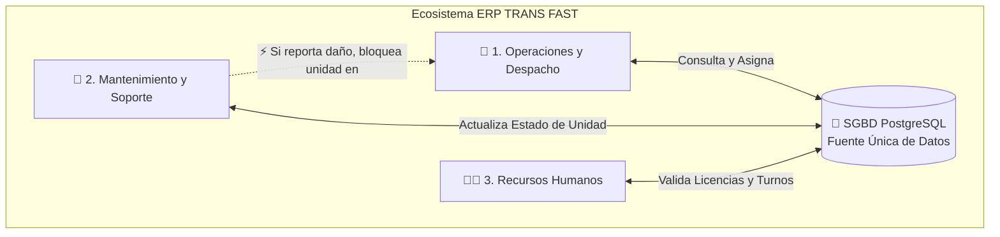
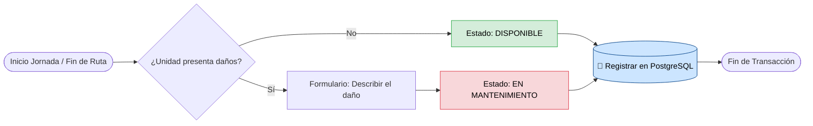
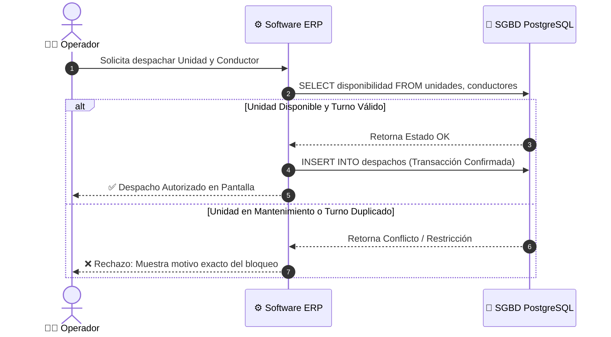

<div align="center" id="top">

<!-- 🌊 ANIMACIÓN 1: Cabecera de onda en movimiento (SVG Dinámico) -->


```text
  _____ ____      _    _   _ ____    _____ _    ____ _____ 
 |_   _|  _ \    / \  | \ | / ___|  |  ___/ \  / ___|_   _|
   | | | |_) |  / _ \ |  \| \___ \  | |_ / _ \ \___ \ | |  
   | | |  _ <  / ___ \| |\  |___) | |  _/ ___ \ ___) || |  
   |_| |_| \_\/_/   \_\_| \_|____/  |_|/_/   \_\____/ |_|  
                                                           
          🚌 SISTEMA ERP DE TRANSPORTE URBANO ⚙️
```

<!-- ⌨️ ANIMACIÓN 2: Subtítulo con efecto de máquina de escribir en vivo -->


<p><i><samp>« Unificando la administración, despacho y monitoreo de transporte público en tiempo real »</samp></i></p>


<br>

<kbd>🏛️ <b>Pontificia Universidad Católica del Ecuador (PUCE)</b></kbd><br>
**Materia:** <samp>Fundamentos de Sistemas de Información</samp><br>
**Autores:** `Juan Diego Almeida Castro` • `Alejandro Ivan Calispa Carvajal` • `Fausto David Chicaiza Vásquez`  

<br>

<!-- Barra de Navegación Rápida -->
<kbd><a href="#-1-tema-y-descripción-del-proyecto">📌 1. Proyecto</a></kbd> •
<kbd><a href="#️-2-problemáticas-a-resolver">⚠️ 2. Problemáticas</a></kbd> •
<kbd><a href="#-3-enfoque-de-solución-por-qué-es-un-erp">💡 3. Solución ERP</a></kbd> •
<kbd><a href="#️-4-arquitectura-de-sistemas-y-componentes-técnicos">🖥️ 4. Arquitectura</a></kbd> •
<kbd><a href="#-5-diseño-y-modelado-bpmn-y-datos">📊 5. Modelado BPMN</a></kbd> •
<kbd><a href="#-bibliografía-y-fuentes">📚 Bibliografía</a></kbd>

</div>

<!-- ⚡ ANIMACIÓN 3: Línea divisoria animada estilo pulso neón -->


<div align="center">

## 📌 1. Tema y Descripción del Proyecto

<!-- 🔄 ANIMACIÓN 4: Indicador de sistema activo en tiempo real -->


</div>

> [!NOTE]
> **TRANS FAST** es una propuesta de Sistema de Planificación de Recursos Empresariales (**ERP**) diseñado para la gestión, despacho y monitoreo de transporte público urbano. 

<p align="center">
  <samp>El proyecto se centra en diseñar un sistema de información integral para las cooperativas y operadoras de transporte, centralizando la administración de las unidades, automatizando la asignación de turnos y estableciendo el control de frecuencias bajo una estructura de datos unificada y trazable.</samp>
</p>

<div align="center">

```text
   [ Cooperativa ] ───► ( Sistema ERP TRANS FAST ) ───► 🚌 Flota Controlada y Puntual
```

| 🎯 <kbd>Centralización</kbd> | ⚡ <kbd>Automatización</kbd> | 🔍 <kbd>Trazabilidad</kbd> |
| :---: | :---: | :---: |
| <sub><i>Unificación administrativa de todas las unidades en una sola base de datos.</i></sub> | <sub><i>Asignación inteligente de turnos, rutas y horarios sin choques operativos.</i></sub> | <sub><i>Monitoreo constante de frecuencias y estados mecánicos en tiempo real.</i></sub> |

</div>


<div align="center">

## ⚠️ 2. Problemáticas a Resolver

<p><sub><i>La propuesta atiende directamente las siguientes falencias en el modelo actual de las operadoras:</i></sub></p>

<!-- 🚨 ANIMACIÓN 5: Alerta dinámica de contraste -->


```text
 ❌ MODELO ACTUAL (Caos y Silos)              ✅ MODELO TRANS FAST (ERP)
┌─────────────────────────────────┐          ┌─────────────────────────────────┐
│ • Horarios al azar              │          │ • Frecuencias automatizadas     │
│ • Buses acumulados o retrasados │   ───►   │ • Módulos 100% conectados       │
│ • Papeles y hojas sueltas       │          │ • Trazabilidad y métricas reales│
└─────────────────────────────────┘          └─────────────────────────────────┘
```

```diff
- ❌ ANTES: Despachos manuales sin validación cruzada de choferes ni estado mecánico.
+ ✅ AHORA: Bloqueo automático de despacho si la unidad está en taller o el turno se duplica.
```

</div>

- 🕒 <kbd>**Ausencia de horarios fijos e irregularidad de frecuencias:**</kbd> <samp>Falta de automatización que provoca despachos aleatorios, largas esperas o superposición de unidades.</samp>
- 🧩 <kbd>**Gestión fragmentada:**</kbd> <samp>Administración manual y en silos de la asignación de buses, turnos de personal y mantenimiento, causando ineficiencias y fallas operativas.</samp>
- 📉 <kbd>**Carencia de métricas y trazabilidad:**</kbd> <samp>Imposibilidad de tomar decisiones basadas en datos por la falta de un registro sistematizado sobre el estado de la red y disponibilidad real de los recursos.</samp>


<div align="center">

## 💡 3. Enfoque de Solución: ¿Por qué es un ERP?

</div>

> [!IMPORTANT]
> Según la definición técnica, un ERP unifica los procesos administrativos y operativos sobre una **fuente única de datos compartida**. *Trans Fast* elimina los silos de información; un evento en un módulo actualiza todo el ecosistema en tiempo real.

<div align="center">

> *(Nota: El siguiente diagrama se visualiza automáticamente en GitHub gracias a Mermaid)*



### 🛠️ Módulos Integrados (Áreas de Negocio)

| Módulo | Función Principal | Corrección / Regla de Negocio Aplicada |
| :---: | :--- | :--- |
| <kbd>**1. Operaciones y Despacho**</kbd><br><sub>*(Logística de Flota)*</sub> | <samp>Planificación de rutas, circuitos y monitoreo de frecuencias.</samp> | **Validación paso a paso:** Todo rechazo o impedimento de despacho (ej. duplicidad de asignación) muestra el `motivo específico en pantalla` sin "atajos" lógicos. |
| <kbd>**2. Mantenimiento y Soporte**</kbd><br><sub>*(Gestión de Activos)*</sub> | <samp>Gestión del ciclo de vida técnico de las unidades.</samp> | **Separación estricta de estados:** Al finalizar jornada, se define en interfaz y matriz si queda `"Disponible"` o si se debe `"Describir el daño"` para pasar a `"En Mantenimiento"`. |
| <kbd>**3. Recursos Humanos**</kbd><br><sub>*(Gestión de Personal)*</sub> | <samp>Registro integral de conductores, vigencia de licencias y turnos.</samp> | **Sincronización:** Solo habilita para despacho a conductores con `licencias vigentes` y dentro de su `turno programado`. |

</div>

<details>
<summary>🔎 <b>Haz clic aquí para desplegar la simulación interactiva de bloqueo entre módulos (Caso de Uso)</b></summary>
<br>

> **Escenario de Bloqueo Preventivo en Tiempo Real:**
> 1. La `Unidad #14` termina su recorrido y el conductor reporta una falla en los frenos.
> 2. El módulo de **Mantenimiento** exige llenar el campo `"Describir el daño"` y cambia el estado en **PostgreSQL** a `EN_MANTENIMIENTO`.
> 3. Si el operador en **Despacho** intenta asignar la `Unidad #14` a una nueva ruta, el sistema consulta la base de datos, detecta el estado activo de taller y **rechaza la operación mostrando en pantalla:**  
>    `⚠️ Error de Despacho: La Unidad #14 se encuentra En Mantenimiento (Falla de frenos).`

</details>


<div align="center">

## 🖥️ 4. Arquitectura de Sistemas y Componentes Técnicos

<!-- 📡 ANIMACIÓN 6: Simulación de tráfico de red y servidor -->


<p><samp>Para asegurar el correcto funcionamiento del ERP y evitar confusiones en los diagnósticos, los recursos y funciones se clasifican rigurosamente:</samp></p>

```text
                     🌐 ENLACE WAN (Comunicación Externa)
                                    │
                            ┌───────▼───────┐
                            │ Router / FW   │
                            └───────┬───────┘
                    ┌───────────────┴───────────────┐
                    ▼                               ▼
          ┌───────────────────┐           ┌───────────────────┐
          │ 🔌 Switch (LAN)   │           │ 📡 Access Point   │
          │ Equipos Cableados │           │ Conexión Wi-Fi    │
          └─────────┬─────────┘           └─────────┬─────────┘
                    │                               │
         ┌──────────▼──────────┐         ┌──────────▼──────────┐
         │ 💻 PCs de Oficina   │         │ 📱 Tablets Taller   │
         └──────────┬──────────┘         └─────────────────────┘
                    │
         ┌──────────▼──────────────────────────────────────────┐
         │ 🖥️ SERVIDOR FÍSICO (Hardware)                       │
         │  ├── ⚙️ Servicios de Aplicación (Software ERP)       │
         │  └── 🐘 SGBD PostgreSQL (Consultas y Transacciones) │
         └─────────────────────────────────────────────────────┘
```

</div>

- 🖥️ <kbd>**Hardware vs. Software:**</kbd> <samp>Se distinguen claramente los servidores físicos (*Hardware*) de los servicios de aplicación (*Software*).</samp>
- 🐘 <kbd>**Rol del SGBD (PostgreSQL):**</kbd> <samp>El Sistema de Gestión de Base de Datos es el único responsable de consultar la disponibilidad (`buses`/`choferes`) y registrar los cambios de estado (`transacciones`). No se deja su función implícita.</samp>
- 🌐 <kbd>**Infraestructura de Red:**</kbd> <samp>En el diseño físico y lógico, se diferencian estrictamente los componentes de red, separando las funciones de los `Switches` (conexión de equipos cableados en oficina) de los `Puntos de Acceso Wi-Fi` y verificando los enlaces `WAN` para la comunicación externa.</samp>

<div align="center">

| Capa Tecnológica | Componente Específico | Rol dentro de TRANS FAST |
| :---: | :---: | :--- |
| <kbd>Hardware</kbd> | `Servidor Central` / `PCs` / `Tablets` | Procesamiento físico e ingreso de datos por parte de operadores y mecánicos. |
| <kbd>Software</kbd> | `Servicios de Aplicación ERP` | Lógica de negocio, validación de formularios e interfaz gráfica de usuario (UI). |
| <kbd>Base de Datos</kbd> | `SGBD PostgreSQL` | Ejecución de consultas SQL, control de concurrencia y registro transaccional ACID. |
| <kbd>Redes</kbd> | `Switch LAN` / `Wi-Fi AP` / `WAN` | Segmentación del tráfico cableado administrativo, inalámbrico de taller y salida a internet. |

</div>


<div align="center">

## 📊 5. Diseño y Modelado (BPMN y Datos)

### Flujo de Verificación Estricta (Lógica BPMN)
<p><sub><i>Los diagramas BPMN están diseñados obligando a que cada ruta de verificación se complete sin saltar compuertas:</i></sub></p>



### 🔄 Secuencia de Validación en Base de Datos (Despacho)
<p><sub><i>Interacción paso a paso entre el Operador, el Software ERP y el motor PostgreSQL:</i></sub></p>



</div>

- 📐 <kbd>**Reglas de Negocio en Diagramas:**</kbd> <samp>Verificación estricta de disponibilidad antes de confirmar una salida y sin omitir compuertas lógicas.</samp>
- 🔗 <kbd>**Trazabilidad:**</kbd> <samp>Cada requerimiento de estado (ej. filtro de unidades pendientes de revisión) se asocia con un **código único** que vincula la base de datos con la visualización del usuario final:</samp>

<div align="center">

<!-- 🔗 ANIMACIÓN 7: Simulación de consulta SQL a UI -->


```text
[ Tabla PostgreSQL: ID_ESTADO_04 ] ══════► [ UI Operador: "Pendiente de Revisión" ]
```

| Código de Trazabilidad | Registro en PostgreSQL | Estado en Interfaz (UI) | Acción del Sistema ERP |
| :---: | :---: | :---: | :--- |
| <kbd>`ID_ESTADO_01`</kbd> | `ESTADO = 'DISPONIBLE'` | 🟢 **Disponible** | Habilita la unidad para asignación de ruta y turno. |
| <kbd>`ID_ESTADO_02`</kbd> | `ESTADO = 'EN_RUTA'` | 🔵 **En Circulación** | Bloquea reasignación para evitar duplicidad de horario. |
| <kbd>`ID_ESTADO_03`</kbd> | `ESTADO = 'MANTENIMIENTO'` | 🔴 **En Mantenimiento** | Exige descripción del daño y bloquea despacho. |
| <kbd>`ID_ESTADO_04`</kbd> | `ESTADO = 'PEND_REVISION'` | 🟡 **Pendiente de Revisión** | Filtra la unidad en el panel técnico de inspección. |

</div>


<div align="center">

## 📚 Bibliografía y Fuentes

</div>

> [!TIP]
> - **Oracle.** (s. f.). *¿Qué es ERP? (Planificación de recursos empresariales).* Oracle América Latina. Recuperado el 30 de octubre de 2026, de https://www.oracle.com/latam/erp/what-is-erp/

<div align="center">

> *(Nota: Todos los conceptos y justificaciones teóricas del diseño provienen de fuentes identificables y verificadas, asegurando la validez académica del modelo de procesos).*

<br>
<kbd><a href="#top">⬆️ Volver arriba</a></kbd>

<!-- 🌊 ANIMACIÓN 8: Pie de página con onda en movimiento -->


</div>
