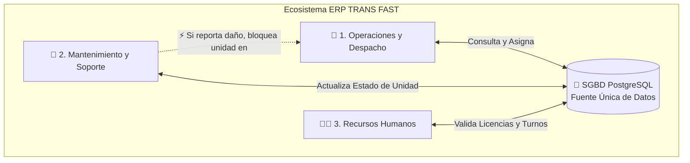

<div align="center">

```text
  _____ ____      _    _   _ ____    _____ _    ____ _____ 
 |_   _|  _ \    / \  | \ | / ___|  |  ___/ \  / ___|_   _|
   | | | |_) |  / _ \ |  \| \___ \  | |_ / _ \ \___ \ | |  
   | | |  _ <  / ___ \| |\  |___) | |  _/ ___ \ ___) || |  
   |_| |_| \_\/_/   \_\_| \_|____/  |_|/_/   \_\____/ |_|  
                                                           
          🚌 SISTEMA ERP DE TRANSPORTE URBano ⚙️
```


**Pontificia Universidad Católica del Ecuador (PUCE)**  
**Materia:** Fundamentos de Sistemas de Información  
**Autores:** Juan Diego Almeida Castro • Alejandro Ivan Calispa Carvajal • Fausto David Chicaiza Vásquez  

</div>

---

## 📌 1. Tema y Descripción del Proyecto

**TRANS FAST** es una propuesta de Sistema de Planificación de Recursos Empresariales (**ERP**) diseñado para la gestión, despacho y monitoreo de transporte público urbano. 

El proyecto se centra en diseñar un sistema de información integral para las cooperativas y operadoras de transporte, centralizando la administración de las unidades, automatizando la asignación de turnos y estableciendo el control de frecuencias bajo una estructura de datos unificada y trazable.

```text
   [ Cooperativa ] ───► ( Sistema ERP TRANS FAST ) ───► 🚌 Flota Controlada y Puntual
```

---

## ⚠️ 2. Problemáticas a Resolver

La propuesta atiende directamente las siguientes falencias en el modelo actual de las operadoras:

```text
 ❌ MODELO ACTUAL (Caos y Silos)              ✅ MODELO TRANS FAST (ERP)
┌─────────────────────────────────┐          ┌─────────────────────────────────┐
│ • Horarios al azar              │          │ • Frecuencias automatizadas     │
│ • Buses acumulados o retrasados │   ───►   │ • Módulos 100% conectados       │
│ • Papeles y hojas sueltas       │          │ • Trazabilidad y métricas reales│
└─────────────────────────────────┘          └─────────────────────────────────┘
```

* 🕒 **Ausencia de horarios fijos e irregularidad de frecuencias:** Falta de automatización que provoca despachos aleatorios, largas esperas o superposición de unidades.
* 🧩 **Gestión fragmentada:** Administración manual y en silos de la asignación de buses, turnos de personal y mantenimiento, causando ineficiencias y fallas operativas.
* 📉 **Carencia de métricas y trazabilidad:** Imposibilidad de tomar decisiones basadas en datos por la falta de un registro sistematizado sobre el estado de la red y disponibilidad real de los recursos.

---

## 💡 3. Enfoque de Solución: ¿Por qué es un ERP?

Según la definición técnica, un ERP unifica los procesos administrativos y operativos sobre una **fuente única de datos compartida**. *Trans Fast* elimina los silos de información; un evento en un módulo actualiza todo el ecosistema en tiempo real.

> *(Nota: El siguiente diagrama se visualiza automáticamente en GitHub gracias a Mermaid)*



### 🛠️ Módulos Integrados (Áreas de Negocio)

| Módulo | Función Principal | Corrección / Regla de Negocio Aplicada |
| :--- | :--- | :--- |
| **1. Operaciones y Despacho**<br>*(Logística de Flota)* | Planificación de rutas, circuitos y monitoreo de frecuencias. | **Validación paso a paso:** Todo rechazo o impedimento de despacho (ej. duplicidad de asignación) muestra el motivo específico en pantalla sin "atajos" lógicos. |
| **2. Mantenimiento y Soporte**<br>*(Gestión de Activos)* | Gestión del ciclo de vida técnico de las unidades. | **Separación estricta de estados:** Al finalizar jornada, se define en interfaz y matriz si queda `"Disponible"` o si se debe `"Describir el daño"` para pasar a `"En Mantenimiento"`. |
| **3. Recursos Humanos**<br>*(Gestión de Personal)* | Registro integral de conductores, vigencia de licencias y turnos. | **Sincronización:** Solo habilita para despacho a conductores con licencias vigentes y dentro de su turno programado. |

---

## 🖥️ 4. Arquitectura de Sistemas y Componentes Técnicos

Para asegurar el correcto funcionamiento del ERP y evitar confusiones en los diagnósticos, los recursos y funciones se clasifican rigurosamente:

```text
                     🌐 ENLACE WAN (Comunicación Externa)
                                    │
                            ┌───────▼───────┐
                            │ Router / FW   │
                            └───────┬───────┘
                    ┌───────────────┴───────────────┐
                    ▼                               ▼
          ┌───────────────────┐           ┌───────────────────┐
          │ 🔌 Switch (LAN)   │           │ 📡 Access Point   │
          │ Equipos Cableados │           │ Conexión Wi-Fi    │
          └─────────┬─────────┘           └─────────┬─────────┘
                    │                               │
         ┌──────────▼──────────┐         ┌──────────▼──────────┐
         │ 💻 PCs de Oficina   │         │ 📱 Tablets Taller   │
         └──────────┬──────────┘         └─────────────────────┘
                    │
         ┌──────────▼──────────────────────────────────────────┐
         │ 🖥️ SERVIDOR FÍSICO (Hardware)                       │
         │  ├── ⚙️ Servicios de Aplicación (Software ERP)      │
         │  └── 🐘 SGBD PostgreSQL (Consultas y Transacciones) │
         └─────────────────────────────────────────────────────┘
```

* **Hardware vs. Software:** Se distinguen claramente los servidores físicos (*Hardware*) de los servicios de aplicación (*Software*).
* **Rol del SGBD (PostgreSQL):** El Sistema de Gestión de Base de Datos es el único responsable de consultar la disponibilidad (buses/choferes) y registrar los cambios de estado (transacciones). No se deja su función implícita.
* **Infraestructura de Red:** En el diseño físico y lógico, se diferencian estrictamente los componentes de red, separando las funciones de los *Switches* (conexión de equipos cableados en oficina) de los *Puntos de Acceso Wi-Fi* y verificando los enlaces *WAN* para la comunicación externa.

---

## 📊 5. Diseño y Modelado (BPMN y Datos)

### Flujo de Verificación Estricta (Lógica BPMN)
Los diagramas BPMN están diseñados obligando a que cada ruta de verificación se complete sin saltar compuertas:


* **Reglas de Negocio en Diagramas:** Verificación estricta de disponibilidad antes de confirmar una salida y sin omitir compuertas lógicas.
* **Trazabilidad:** Cada requerimiento de estado (ej. filtro de unidades pendientes de revisión) se asocia con un **código único** que vincula la base de datos con la visualización del usuario final:

```text
[ Tabla PostgreSQL: ID_ESTADO_04 ] ══════► [ UI Operador: "Pendiente de Revisión" ]
```

---

## 📚 Bibliografía y Fuentes

* Oracle. (s. f.). *¿Qué es ERP? (Planificación de recursos empresariales).* Oracle América Latina. Recuperado el 30 de octubre de 2026, de https://www.oracle.com/latam/erp/what-is-erp/

> *(Nota: Todos los conceptos y justificaciones teóricas del diseño provienen de fuentes identificables y verificadas, asegurando la validez académica del modelo de procesos).*
